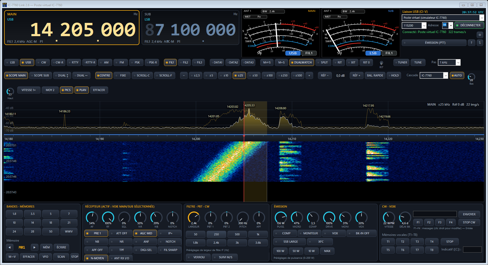

# IC-7760 Link — par F5PBG, 2026

*[English version below](#english)*

**IC-7760 Link** est une télécommande complète de l'**ICOM IC-7760** par la liaison USB (protocole **CI-V**), avec une **cascade (waterfall)** haute qualité. Logiciel **portable** pour Windows 10 / 11 : un seul `IC7760Link.exe`, aucune installation.



*Capture réalisée avec le poste virtuel intégré (simulateur).*

## Fonctions

- **Cascade et spectre** calculés à la résolution de l'écran, défilement fluide entre deux trames, 8 palettes + palette personnalisée (10 couleurs réglables, palette 64 couleurs et RVB), niveau automatique, moyennage 1 à 20, vitesse x0,1 à x5, maintien des crêtes avec fréquences affichées sur les crêtes, plan de bandes, heure UTC dans la cascade, échelle de fréquence au 1/10.
- **Scope** MAIN, SUB ou double (haut/bas, côte à côte) : modes Centre / Fixe / Scroll-C / Scroll-F, largeur ±2,5 à ±500 kHz, niveau de référence, vitesse de balayage, Hold. Le curseur reste strictement au centre en mode Centre.
- **Accord** par clic ou glisser sur la cascade, molette, zoom Ctrl + molette, clic sur une étiquette de signal, chiffres cliquables, saisie directe.
- **Poste** : MAIN/SUB (fréquence, mode, filtres, DATA), Dualwatch, Split, RIT/XIT, tuner, largeur de filtre, PBT, AF/RF/SQL, PRE/ATT/AGC, NB/NR/ANF/notch/APF/TPF/DIGI-SEL/IP+, puissance, micro, compresseur, drive, moniteur, VOX, BK-IN, CW (texte libre, messages F1-F4), mémoires vocales, bandes, mémoires, scan.
- **Vumètres** en barres ou **à aiguille façon écran IC-7760** (S, Po, SWR, ALC, COMP, Vd, Id), MAIN et SUB côte à côte.
- **Options** : couleurs du waterfall et de toute l'interface (chiffres de fréquence MAIN/SUB, fonds, textes…), réglages avancés du poste (catalogue de **530 commandes CI-V**, dont tout le menu SET), monitoring et détection CI-V.
- **Verrous** (clic droit sur un bouton ou un potentiomètre, mémorisés), limite de puissance **P.MAX**, vitesse de la molette réglable, puissance moyennée avec repère de crête sur le vumètre à aiguille.
- **Export / import** de toute la configuration, y compris les réglages du poste affichés sur les potentiomètres et boutons.
- **Fenêtre redimensionnable à l'identique** : proportions conservées, rien n'est tronqué, aucun ascenseur.
- **Poste virtuel** intégré pour essayer le logiciel sans poste, et **autotest** (`--selftest`).
- **Détection automatique de l'adresse CI-V** (94h ou B2h), outil de détection du poste et **diagnostic** pour dépanner une liaison muette.
- Le logiciel ne pilote **jamais** DTR/RTS (pas d'émission accidentelle par la ligne série).

## Télécharger

**[Télécharger la dernière version](https://github.com/F5pbgLudovic/IC7760Link/releases/latest)** (`IC7760Link-X.Y.zip`). Extrayez le zip dans un dossier puis lancez `IC7760Link.exe`. Les réglages sont mémorisés dans le dossier `data` à côté de l'exe.

## Mise en route

1. **Sans poste** : choisir « Poste virtuel (simulateur IC-7760) » puis CONNECTER.
2. **Avec le poste** : brancher l'USB, choisir le port COM, 115200 bauds, adresse CI-V 94 (ou B2), CONNECTER.
3. Liaison muette : ⚙ → *Monitoring et détection CI-V* → *Détecter le poste…*.

Le mode d'emploi complet est dans **[AIDE.md](AIDE.md)**. Pour un premier essai sur un vrai poste avec retour d'informations, voir [dist/AIDE-POUR-L-AMI.txt](dist/AIDE-POUR-L-AMI.txt).

## État du projet

Développé contre un **poste virtuel** (autotest complet) ; premiers essais sur un IC-7760 réel : connexion et cascade confirmées. Le reste (écriture des réglages, émission) doit être validé poste par poste : **testez l'émission sur charge fictive**, à faible puissance. Les retours sont bienvenus : ouvrez une [issue](https://github.com/F5pbgLudovic/IC7760Link/issues) avec le fichier `diagnostic-ci-v.txt` (voir l'aide).

## Compiler

```
powershell -ExecutionPolicy Bypass -File build.ps1
```

Utilise le compilateur .NET Framework 4 fourni avec Windows (C# 5) : rien à installer. Résultat dans `dist\IC7760Link.exe`. Le catalogue `doc\ic7760.civ` est intégré à l'exe. Voir [CLAUDE.md](CLAUDE.md) et [docs/adr](docs/adr) pour l'architecture et les décisions.

## Licence

[GPL v3](LICENSE). Projet indépendant, **non affilié à ICOM**. « ICOM » et « IC-7760 » sont des marques de leurs propriétaires. Voir [THIRD-PARTY-NOTICES.md](THIRD-PARTY-NOTICES.md).

73 de F5PBG

---

<a name="english"></a>
# IC-7760 Link — by F5PBG, 2026

**IC-7760 Link** is a full remote control for the **ICOM IC-7760** over USB (**CI-V** protocol) with a high-quality **waterfall**. Portable Windows 10/11 software: a single `IC7760Link.exe`, no installation.

**Highlights**
- Spectrum and waterfall rendered at screen resolution, smooth scrolling, 8 palettes + a custom 10-colour palette (64-colour grid and RGB picker), auto level, averaging, peak hold with frequency labels, UTC time scale in the waterfall, MAIN / SUB / dual scope.
- Full radio control (MAIN/SUB, modes, filters, NB/NR/notch, TX levels, CW, voice memories, bands and memories), bar graphs or analogue needle meters styled like the IC-7760 screen.
- Options: colours of the waterfall and of the whole interface, all 530 CI-V commands (including the SET menu), CI-V monitor with automatic address and speed detection.
- Export / import of the whole configuration including the radio settings shown on the controls.
- Proportional window scaling (no cut-off, no scroll bars), built-in virtual radio and self-test.
- The software never toggles DTR/RTS.

**Download**: [latest release](https://github.com/F5pbgLudovic/IC7760Link/releases/latest) (`IC7760Link-X.Y.zip`), extract and run `IC7760Link.exe`. User guide (French): [AIDE.md](AIDE.md).

**Status**: developed against a virtual radio; first tests on a real IC-7760 confirmed the connection and the waterfall. Transmit and write functions still need validation on real stations — test on a dummy load at low power. Feedback welcome through [issues](https://github.com/F5pbgLudovic/IC7760Link/issues).

**Build**: `powershell -ExecutionPolicy Bypass -File build.ps1` (uses the .NET Framework compiler shipped with Windows).

Licence: GPL v3. Independent project, not affiliated with ICOM.

73 de F5PBG
